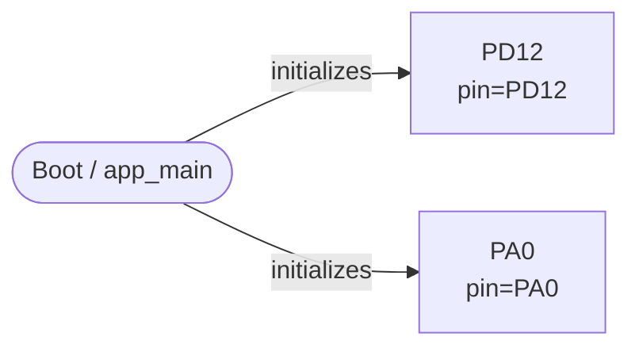
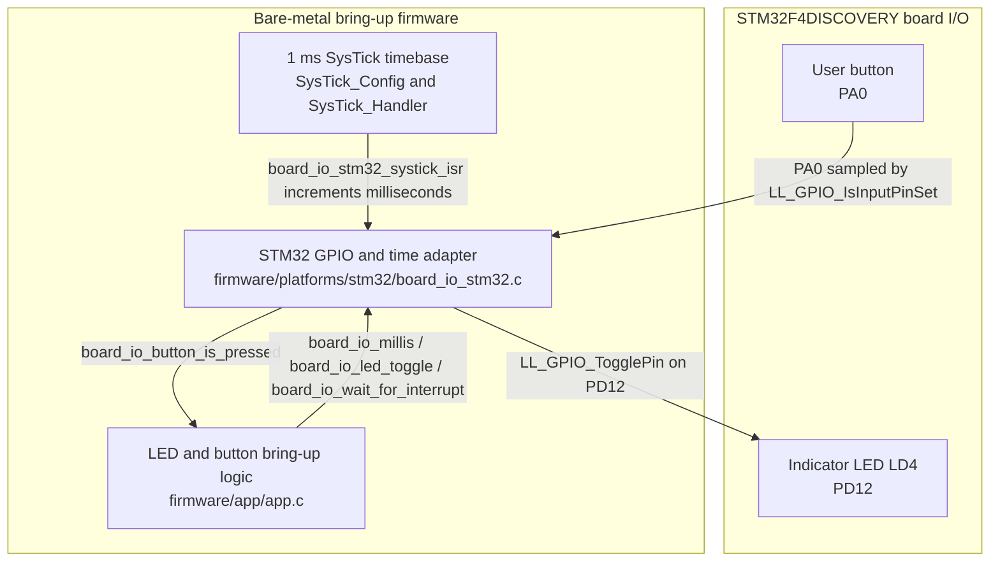
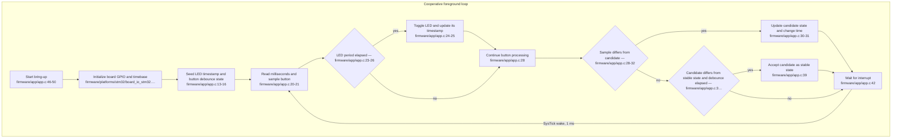
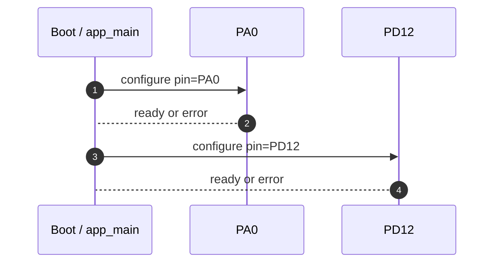
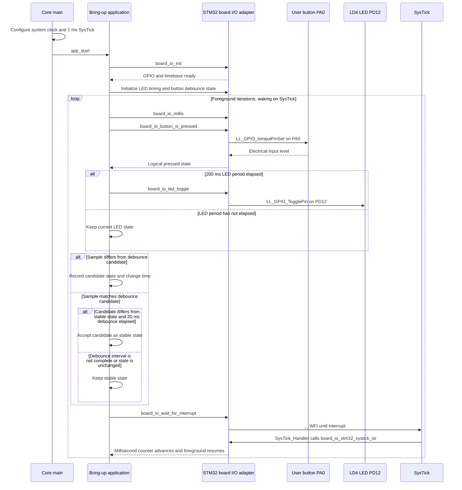
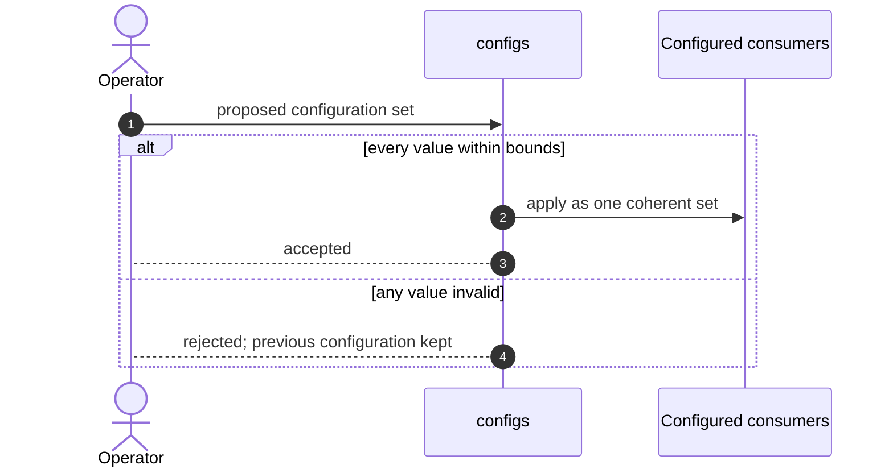

# Firmware Design Specification — my_firmware

| Field | Value |
| --- | --- |
| Document ID | FDS-MY-FIRMWARE-001 |
| Project | my_firmware |
| PIR revision | 20b29c5b00cbfa9283c3fa8efecc8ed3 |
| Board | not recorded |
| Target | not recorded |
| Generated | 2026-10-15 18:11 UTC |
| Analysed files | 24 |
| Diagrams reviewed | not yet |
| Requirements workbook | none linked |
| Status | Generated from the as-built project |

> Generation rule: unresolved implementation details are surfaced as editable parameters or design decisions. They are not silently converted into fixed product behavior.

## 1. Purpose and Scope

This firmware is an STM32-oriented GPIO prototype with PA0 recorded as an input and PD12 as an output. Its analysed scope includes the application, board-support and STM32 board-I/O layers; no tasks or transports are identified.

### 1.1 Source Basis

| Source | Use in this specification |
| --- | --- |
| Analysed project sources (24 files) | Primary input. Every module, task flow, pin binding and partition in this document is read from these files. |
| PIR revision 20b29c5b00cbfa9283c3fa8efecc8ed3 | The exact analysis this document describes. Regenerating after a source change produces a different revision. |

### 1.2 Modelling Basis

The structure of this document follows the information content of an IEEE 1016 software design description and the viewpoint structure of ISO/IEC/IEEE 42010. Interaction diagrams use UML sequence notation. The structure is a reference template; it does not claim certification to those standards.

### 1.3 Design Principles

- The `app` and `bsp` modules are separated into application and board-support layers.
- The `interfaces` module and `platforms/stm32` module separate the board-I/O interface from its STM32 platform implementation.
- The `configs` module keeps configuration files separate from the application and platform modules.

### 1.4 Analysed Source Inventory

| File | Module | Module kind | Facts read from this file |
| --- | --- | --- | --- |
| CMakeLists.txt | — | — | read; no facts cited from it |
| Core/Inc/main.h | Core/Inc | module | read; no facts cited from it |
| Core/Inc/stm32_assert.h | Core/Inc | module | read; no facts cited from it |
| Core/Inc/stm32f4xx_hal_conf.h | Core/Inc | module | read; no facts cited from it |
| Core/Inc/stm32f4xx_it.h | Core/Inc | module | read; no facts cited from it |
| Core/Src/main.c | Core/Src | module | 1 topology element(s); 2 include dependency(ies) |
| Core/Src/stm32f4xx_it.c | Core/Src | module | 1 include dependency(ies) |
| Core/Src/system_stm32f4xx.c | Core/Src | module | read; no facts cited from it |
| firmware/app/app.c | app | application | 2 include dependency(ies) |
| firmware/app/app.h | app | application | read; no facts cited from it |
| firmware/bsp/board.c | bsp | board | read; no facts cited from it |
| firmware/bsp/board.h | bsp | board | 1 include dependency(ies) |
| firmware/configs/app_config.h | configs | configuration | read; no facts cited from it |
| firmware/configs/build_config.h | configs | configuration | read; no facts cited from it |
| firmware/configs/feature_config.h | configs | configuration | read; no facts cited from it |
| firmware/configs/platform_config.h | configs | configuration | read; no facts cited from it |
| firmware/interfaces/board_io.h | interfaces | module | read; no facts cited from it |
| firmware/osal/osal.h | osal | abstraction | read; no facts cited from it |
| firmware/platforms/stm32/board_io_stm32.c | platforms/stm32 | platform | 2 topology element(s); 3 include dependency(ies) |
| firmware/platforms/stm32/board_io_stm32.h | platforms/stm32 | platform | read; no facts cited from it |
| firmware/utils/helpers/helpers.c | utils/helpers | utility | read; no facts cited from it |
| firmware/utils/helpers/helpers.h | utils/helpers | utility | read; no facts cited from it |
| firmware/utils/logger/logger.c | utils/logger | utility | read; no facts cited from it |
| firmware/utils/logger/logger.h | utils/logger | utility | read; no facts cited from it |

## 2. System Context and Wiring Topology

> The diagrams in this document have not been marked reviewed in the Firmware Topology panel. They describe the analysed project as it stands; review them there before treating this document as approved.

**Figure 1.** Wiring and external connectivity topology.

### 2.1 Wiring Control Table

| Connection | Baseline | Editability | Verification |
| --- | --- | --- | --- |
| PA0 | PA0 | Platform — regenerated from the board configuration | Pin is input-capable at the expected level. |
| PD12 | PD12 | Platform — regenerated from the board configuration | Pin exists on the target and is drive-capable. |

### 2.2 Dynamic Design Parameters

| Parameter group | Resolved baseline | Still requires decision |
| --- | --- | --- |
| Peripherals | 2 peripheral(s): PA0, PD12 |  |

### 2.3 Peripheral and Interface Configuration

| Element | Type | Configured values | Source |
| --- | --- | --- | --- |
| Boot / app_main | system_init | target = stm32 | Core/Src/main.c |
| PD12 | gpio_output | pin = PD12 | firmware/platforms/stm32/board_io_stm32.c |
| PA0 | gpio_input | pin = PA0 | firmware/platforms/stm32/board_io_stm32.c |

## 3. High-Level Design (HLD)

**Figure 2.** High-level layered firmware architecture and dependency direction.

### 3.1 Architectural Layers

| Layer | Source modules | Runtime and hardware elements |
| --- | --- | --- |
| Application | app | — |
| Platform and drivers | bsp, osal, platforms/stm32 | PD12, PA0 |
| Configuration and support | configs, utils/helpers, utils/logger | Boot / app_main |

### 3.3 Shared Data and Synchronisation

The brief identifies no tasks, so it does not establish task-to-task state flow or synchronization protection. It records PA0 as an input and PD12 as an output, but does not specify how their state is shared between components.

## 4. Low-Level Design (LLD)

**Figure 3.** Low-level module contracts and runtime control flow.

**Figure 4.** Peripheral service state machine for initialisation, fault containment and controlled recovery.

*Not drawn — a fault and recovery state machine needs an analysed task flow carrying both a decision step and an error step. No task flow in this project has both.*

### 4.1 Module Contracts

| Module | Kind | Files | Depends on | Trace |
| --- | --- | --- | --- | --- |
| Core/Inc | module | 4 | — | Core/Inc |
| Core/Src | module | 3 | Core_Inc, app, platforms_stm32 | Core/Src/main.c:20 |
| app | application | 2 | configs, interfaces | firmware/app/app.c:7 |
| bsp | board | 2 | configs | firmware/bsp/board.h:18 |
| configs | configuration | 4 | — | configs |
| interfaces | module | 1 | — | interfaces |
| osal | abstraction | 1 | — | osal |
| platforms/stm32 | platform | 2 | bsp, configs, interfaces | firmware/platforms/stm32/board_io_stm32.c:8 |
| utils/helpers | utility | 2 | — | utils/helpers |
| utils/logger | utility | 2 | — | utils/logger |

### 4.2 Key Data Contracts

The only recorded peripheral-level contract is PA0 as a GPIO input and PD12 as a GPIO output. The brief does not establish exchanged fields, message formats, or other data contracts.

### 4.4 Include Dependencies

| From | To | Via | Symbol | Trace |
| --- | --- | --- | --- | --- |
| Core/Src | Core/Inc | include | main.h | Core/Src/main.c:20 |
| Core/Src | app | include | app.h | Core/Src/main.c:21 |
| Core/Src | platforms/stm32 | include | board_io_stm32.h | Core/Src/stm32f4xx_it.c:23 |
| app | configs | include | app_config.h | firmware/app/app.c:7 |
| app | interfaces | include | board_io.h | firmware/app/app.c:8 |
| bsp | configs | include | app_config.h | firmware/bsp/board.h:18 |
| platforms/stm32 | bsp | include | board.h | firmware/platforms/stm32/board_io_stm32.c:8 |
| platforms/stm32 | configs | include | app_config.h | firmware/platforms/stm32/board_io_stm32.c:7 |
| platforms/stm32 | interfaces | include | board_io.h | firmware/platforms/stm32/board_io_stm32.c:2 |

## 5. Sequence Diagrams

**Figure 5.** Startup and initialisation sequence.

**Figure 6.** Normal acquisition, processing and output sequence.

**Figure 7.** Fault detection and controlled recovery sequence.

*Not drawn — a fault recovery sequence needs both a task flow with an error path and a diagnostics or logging sink to report it to. This project does not have both.*

**Figure 8.** Validated and atomic configuration update sequence.

**Figure 9.** Secure firmware download, verification, staging and activation sequence.

*Not drawn — no firmware update surface was found: no OTA or update node, and no OTA partition.*

## 6. Security and Update Design

### 6.1 Security and Update Surface

| Surface | Found in the analysed project | Consequence for this design |
| --- | --- | --- |
| Update slot | No OTA partition among the 0 declared | The image can only be replaced over the wire by re-flashing. |
| Update service | No OTA or update element in the topology | Figure 9 is not drawn; there is no update flow to verify. |
| Secure boot and flash encryption | Not visible to static source analysis | Confirm against the build configuration; this document cannot establish either. |

## 7. Timing and Resource Budget

| Budget item | Requirement / baseline | Design status | Closure evidence |
| --- | --- | --- | --- |
| Flash, RAM and CPU headroom | Not established by static analysis | Decision Required | Map file plus runtime resource measurement. |

## 8. Design Decision Register

> The analyser recorded no unresolved parameter at this revision, so there is no open decision to register here. Every parameter group in section 2.2 resolved to a baseline, and the items section 7 marks as requiring a decision are measurements rather than design choices.

## 9. Requirement-to-Design Traceability

> No requirements workbook is linked to this project, so no requirement can be traced to a design element here. Link one from the project picker to populate this section.

## 10. References

| Reference | Purpose |
| --- | --- |
| Project sources at revision 20b29c5b00cbfa9283c3fa8efecc8ed3 | The implementation this document describes. |

## 11. Consolidated Design Summary

The analysed firmware is organized into application, board-support, configuration, interface, platform, and utility modules. At the hardware boundary, the recorded GPIOs are PA0 as an input and PD12 as an output. The brief identifies no tasks, so it does not establish what the runtime does on each cycle. No buses, network transports, or sinks are recorded as destinations for data leaving the device. The module separation and the two GPIO roles are established, but detailed runtime behavior and data contracts are not specified in the brief. No open decisions are recorded.

### 11.1 The Design at a Glance

| Aspect | As built at this revision |
| --- | --- |
| Target | Neither target chip nor board is recorded |
| Analysed sources | 24 file(s) across 10 module(s) and 0 build component(s) |
| Topology | 3 element(s) and 2 connection(s), of which 2 are evidenced in source |
| Peripherals | PA0, PD12 |
| Runtime | No task was resolved to a defined entry function |
| Network | No network transport is configured |
| Storage | No partition table was read |
| Figures | 6 of 9 drawn; the remaining 3 state why they are not |
| Open design decisions | None recorded; every parameter group in §2.2 resolved |
| Requirement traceability | No workbook is linked, so nothing is traced |
| Diagram review | Not yet marked reviewed; the figures describe the project as analysed |
| Analysis provenance | pir_maker-static-0.13.0 in static mode; validation reports 0 error(s) and 0 warning(s) |

## 12. Appendix A — Term, API and Symbol Index

> Every term below is a name the body of this document uses, resolved against the 140 name(s) indexed from the 24 analysed source file(s). 12 term(s) are listed; 39 name-like token(s) in the document resolved to no recorded location and are omitted rather than listed without one.

| Term | Kind | Defined or referenced at | Where it appears in this document |
| --- | --- | --- | --- |
| LL_GPIO_IsInputPinSet | external API | firmware/platforms/stm32/board_io_stm32.c:52 | figure 2, 6 |
| LL_GPIO_TogglePin | external API | firmware/platforms/stm32/board_io_stm32.c:47 | figure 2, 6 |
| SysTick_Config | external API | Core/Src/main.c:107 | figure 2 |
| SysTick_Handler | function | Core/Src/stm32f4xx_it.c:120 | figure 2, 6 |
| __WFI | external API | firmware/platforms/stm32/board_io_stm32.c:65 | figure 6 |
| app_start | function | firmware/app/app.c:45 | figure 6 |
| board_io_button_is_pressed | function | firmware/platforms/stm32/board_io_stm32.c:50 | figure 2, 6 |
| board_io_init | function | firmware/platforms/stm32/board_io_stm32.c:15 | figure 6 |
| board_io_led_toggle | function | firmware/platforms/stm32/board_io_stm32.c:45 | figure 2, 6 |
| board_io_millis | function | firmware/platforms/stm32/board_io_stm32.c:58 | figure 2, 6 |
| board_io_stm32_systick_isr | function | firmware/platforms/stm32/board_io_stm32.c:68 | figure 2, 6 |
| board_io_wait_for_interrupt | function | firmware/platforms/stm32/board_io_stm32.c:63 | figure 2, 6 |

